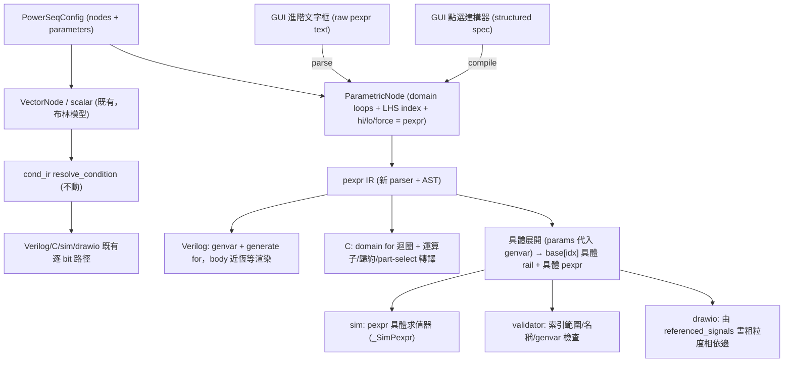

# 參數化向量條件 v2（freeexpr + domain 迴圈）

## 背景與決策（本輪覆蓋先前方案）

使用者貼出真實 `generate` 區塊（`NUM_CPU`/`NUM_CPU_MEM` 為 parameter），並選定：
- **內部表示＝pexpr（freeexpr 等級）**：單一內部運算式 IR，需支援 `?:`、`== != < <= > >=`、歸約 `& | ~| ~& ^`、part-select `[a+:w]`、固定切片 `[hi:lo]`、固定索引 `[0]`、genvar/parameter 算術索引、`|| && | & ~`、常數 `2'b00`、`force_on` 具名純量。先前「布林 group 模型」決定就此作廢（該模型無法表達三元/比較/歸約）。
- **授權前端＝全點選結構化建構器 + 進階文字逃生（hybrid）**：使用者**主要用下拉＋勾選**組條件，不打字；建構器 spec 編譯成 pexpr。另保留「進階模式」文字框（直接輸入 pexpr 文字）供少數點選組不出來的刁鑽行（如 part-select 對 part-select 比較、多層巢狀）。每個條件（hi/lo/force）只會是「結構化」或「進階文字」其一，進階文字不反向還原成建構器列。
- **迴圈組織＝domain**：同一索引域的訊號收進同一個 generate 巢（CPU 域、CPU×MEM 域）。
- **邊界分支＝使用者自訂 genvar 述詞（點選）**：不寫死成「第 0 個」（`gv_cpu==0`），而是由使用者以下拉選比較子＋切點值（如 `gv_cpu <= n`、`< NUM_CPU-1`、`>= 1`；`n` 可為整數或 parameter）決定在哪切，產生兩分支 A/B，各自是一組結構化群組。編譯成 pexpr 的 `Ternary(BinOp(genvar,cmp,value), A, B)`。比較運算子須齊備 `< <= > >= == !=`。

### 結構化建構器的「項類型」（v1 皆可點選）
- 同索引項 `V[i]`、固定 bit 項 `V[0]/V[k]`、歸約項（全部 `&`／任一 `|`／NOR `~|`）、part-select 項 `V[a+:w]`（係數×genvar＋偏移、寬度皆下拉）、比較項（左運算元 vs 常數或另一訊號，比較子下拉）。`force_on` 以純量訊號項表示，不另設型別。
- 群組沿用既有：群組內 `AND/OR`、群組間 OR。每項可勾選反相。

### 不變量（硬約束）
- `src/core/cond_ir.py` 語意不改；parametric 節點**完全繞過** cond_ir，不經 `resolve_condition`。
- 非 parametric／非 vector 的 golden 逐位元組不變：`tests/golden/demo.v`、`demo.c`、`demo_json.json`、`demo.drawio.xml`、`demo_sim.json`、`demo_schemdraw.json`、`demo_vector.c`。parametric 功能一律加**新** fixture。
- 不 commit/push（使用者持有）；PowerShell 用 `;`。
- 索引整數層一律走 `core/param_expr.py` 的 AST 白名單求值，不用 `eval()`。

### 刻意排除（範圍邊界，先不做）
- 不逐位元組重現使用者貼的那份檔案；目標是**同風格同語意**。
- Verilog 預設以 `generate for` + 每個 assign 內嵌 `?:` 表達邊界（使用者自訂述詞，如 `(gv_cpu <= n) ? a : b`），**不**重建 `if(...) begin…end else begin…end` 的區塊合併（語意等價、較簡）。若之後要 if/else 區塊再加。
- 不支援任意 Verilog 語法（如 casex、函式呼叫）；僅上列運算子集合。
- 結構化建構器 v1 **只支援單層邊界切分**（一個 A/B）；多層巢狀 `?:`、part-select 對 part-select 比較、鏈式比較一律走「進階文字框」逃生。
- 進階文字框的內容**不**反向解析回建構器列（單向：spec → pexpr；text → pexpr）。

## 架構

核心橋接：parametric 節點 `elaborate()` 在具體 parameter 值下，對每個 genvar tuple 產生具體 `base[idx]` 的 `PowerRail`，並把「索引代入後的具體 pexpr」掛在該 rail 的新選用欄位 `pexpr_hi/pexpr_lo/pexpr_force`（None 表非 parametric → 走舊路徑，to_dict 省略，golden JSON 不變）。

## 新增／修改檔案

- 新增 `src/core/pexpr.py`：參數化運算式 AST + 白名單 parser + 能力：
  - 節點：`Ref(name, index_expr | part_select(base_expr,width) | slice(hi,lo) | scalar)`、`Reduce(op, operand)`、`Const`（含 `N'bxxx`/`force_on` 具名）、`BinOp(|| && | & ^ == != < <= > >=)`、`Unary(~ !)`、`Ternary(cond,a,b)`。`Ternary.cond` 可為任意 genvar/parameter 比較述詞（邊界切點由使用者決定）。索引/寬度子式委派 `param_expr._eval_node` 風格求值。
  - 方法：`parse(text) -> Node`、`referenced_bases(node) -> set[str]`、`free_genvars(node)`、`substitute(node, genvar->int)`、`render_verilog(node)`（近恆等）、`eval_concrete(node, env)`（env: rail 名→0/1，給 sim）。
- 修改 `src/core/config_models.py`：
  - 新 `ParametricNode(base, width_expr, domain: list[(genvar, bound_param)], index_expr, hi, lo, force)`；每個 hi/lo/force 為「結構化 spec」或「進階文字」其一，兩者皆可 `to_pexpr()`。`elaborate()` 依 `eval_width` 展開域，產出具體 `base[idx]` rails 並掛具體 pexpr；`to_dict/from_dict` round-trip（含 spec/text 形態標記）。
  - `PowerRail` 加選用 `pexpr_hi/lo/force=None`（to_dict 於 None 時省略 → golden JSON 不變）。
- 新增結構化建構器 spec 與 `spec → pexpr` 編譯（放 `src/core/` 新模組，如 `pexpr_build.py`）：資料類描述群組/項/邊界切分；`compile(spec) -> pexpr.Node`。GUI 與序列化共用，不在 widget 裡散落邏輯。
- 修改 `src/codegen/verilog_generator.py`：parametric 節點依 domain 分組 → 輸出 `genvar gv_…;` + 巢狀 `generate for`，內 `assign <lhs[idx]> = <render_verilog(body)>;`；非 parametric 維持現有逐 bit（golden `demo.v` 不變）。
- 修改 `src/codegen/c_generator.py`：parametric 群組出 domain `for` 迴圈，body 轉譯運算子／三元／`==`／part-select／歸約（歸約與 part-select 於參數寬度下展開為 runtime 迴圈/輔助式）；非 parametric 不變（golden `demo.c`/`demo_vector.c` 不變）。**最重且風險最高的階段**。
- 修改 `src/timing/timing_sim.py`：parametric rail（`pexpr_* is not None`）用新 `_SimPexpr` 求值器取代 `resolve_condition`；其餘不變。
- 修改 `src/core/validator.py`：加 parametric 檢查（genvar 已宣告為 domain 變數、索引對所有具體 i 落在寬度內、referenced base 存在、LHS 不重複、運算式可 parse）。
- 修改 `src/gui/widgets.py`（`RailEditorFrame`）：加「Parametric」切換；條件分頁改**全點選結構化建構器**——domain/genvar/bound 下拉、LHS index 由係數×genvar＋偏移下拉組、邊界切分（比較子＋切點下拉）A/B、群組/項（訊號＋取法＋反相，取法沿用既有 vector 下拉並擴充 part-select/歸約）＋比較項；每個 hi/lo/force 有「進階」切換露出單行 pexpr 文字框（逃生）。具體展開預覽（可切 bit 檢視）。
- 文件：`README.md`、`doc/FUTURE.md`、`doc/ROADMAP.md`（若有）同步。

## 階段（可增量交付，Verilog 先能動）

1. **pexpr 核心**：AST + 白名單 parser + `render_verilog`/`eval_concrete`/`referenced_bases`/`substitute`。先紅測試（parse/eval/render round-trip，含 `?:`、`~|`、`[a+:w]`、`==`）。不接管線，golden 全不變。
2. **config 模型**：`ParametricNode` + `elaborate()` + `PowerRail.pexpr_*` + to_dict/from_dict。紅測試；`demo_json.json` byte 不變（None 省略）。
3. **Verilog 後端**：domain 分組 → genvar + generate for + 內嵌 `?:` body。新 fixture 鎖「範例一」風格輸出；`demo.v` byte 不變。
4. **sim + validator + drawio 接線**：parametric 走獨立求值/檢查/粗粒度相依邊；`cond_ir` 不動。紅測試。
5. **C 後端**：domain for 迴圈 + body 轉譯（含歸約/part-select 的 runtime 展開）。新 fixture；`demo.c`/`demo_vector.c` byte 不變。
6. **GUI + 文件 + 驗收**：全點選結構化建構器 + 進階文字逃生 + 具體預覽；widget 測試；README/FUTURE/ROADMAP；`ci.bat` 全綠。

每階段先讓測試紅、再最小實作、跑 `ci.bat`（`ruff check .` + `pytest -q`）全綠才進下一階段。
