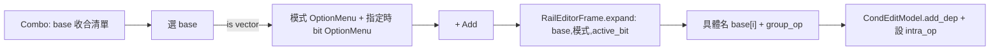

# 甲：vector 相依下拉收合（GUI 糖衣）

## 目標與邊界
- 條件相依下拉：vector 不再逐 bit 展開，每個 base 只出現一筆；選到 vector 時出現「模式」與（指定時）「bit」控制。
- 按 `+ Add` 在 GUI 層把 `(base, 模式, bit)` 展開成**具體 `base[i]` 相依名**寫入目前 active bit 的 `CondEditModel`。儲存格式與今天完全相同（具體名字串 + 既有 `intra_op`）。
- 硬邊界：**不動** [src/core/cond_ir.py](src/core/cond_ir.py) 語意、不動序列化/`PowerRail`、不動五後端產生器。`tests/golden/` byte 不變。

## 為什麼零核心改動
四種模式全部化約成產生器已支援的葉參照（跨 bit 索引 `pg_deb[i]` 已修好）：
- 同索引 → 目前 active bit `i` 的 `base[i]`
- 全部(AND) → 群組裝 `base[0..N-1]` 且該群組 `intra_op=and`
- 任一(OR) → 群組裝 `base[0..N-1]` 且該群組 `intra_op=or`
- 指定 → `base[k]`

`cond_ir.resolve_dep` 靠 `name_to_rail[dep]` 查表，`base[i]` 即 canonical rail 名（[`_bit_name`](src/core/config_models.py)），故這些相依與現況逐 bit 選取等價。

## 資料流

## 主要改動（全部在 [src/gui/widgets.py](src/gui/widgets.py)）

### 1. `RailEditorFrame`：收合清單 + 展開邏輯（唯一知道 vector 結構處）
- `_dep_options()`（現 line ~868）改收合：每個 `group_base` 只一筆，scalar 用自身名，末端補 `High/Low`。
- 新增 `_dep_vector_width(sel) -> int | None`：數 `get_all_rails()` 中 `group_base==sel` 的 bit 數。
- 新增 `_expand_dep(sel, mode, bit) -> (list[str], str | None)`：回傳具體名與需要設定的 `group_op`；`High/Low`/scalar 回 `([sel], None)`；vector 依模式用 `_bit_name(sel, i)`（同索引取 `min(self._active_bit, N-1)`）。
- 新增 `_owner_is_vector()`（回 `self.is_vector()`）供 UI 決定是否顯示「同索引」。
- `_build_bit_editor`（line ~1152）建 `CondSectionFrame` / `InputWaveCondFrame` 時，注入一個輕量 helper 物件 `vec_dep`（打包上述四個方法），取代「再多傳四個 callable」。

### 2. `CondGroupFrame`：下拉旁的模式/ bit 控制 + 展開式新增
- `__init__`（line ~34）新增 `vec_dep=None`（None 時行為與今天完全一致，既有測試不動）。
- `_add_group_ui`（line ~142）：combo 右側加 `mode` OptionMenu（同索引/全部(AND)/任一(OR)/指定）與 `bit` OptionMenu（預設隱藏）；bind combo `command`：選到 vector 才顯示模式控制，模式=指定才顯示 bit 清單（`0..N-1`），owner 非 vector 時隱藏「同索引」。
- `_add_cond_to_group`（line ~314）：改呼叫 `vec_dep.expand(sel, mode, bit)`；若回傳 `group_op` 則設 `self.model.group_intra_op[gi]` 並同步該 group 的 op 變數/重繪；對每個展開名沿用現有 `High/Low→DEP_*` 映射後 `model.add_dep` + `_add_cond_row`。

### 3. 向下串接
- `CondSectionFrame.__init__`（line ~619）與 `InputWaveCondFrame`（line ~754）各加 `vec_dep=None` 並往 `CondGroupFrame` 傳（line ~675 / ~770）。input timing 與 output 條件共用同一套 UI，一併受益。

## 模式→群組語意的明確規則（寫進 docstring）
- 全部/任一會**設定整個 group 的 `intra_op`**（and/or）。預期用法是「在新群組加一筆 reduction」；若群組已有其他 op 的項目，會被覆蓋為該 op（可預期、有文件）。
- 同索引固定對應「目前 active bit」；owner 比 target 窄時取 `min(active_bit, N-1)`。
- 現有條件列仍顯示具體名（`PG[2]`），不受收合影響；收合只作用於「新增用的 combo」。

## 測試
- 新增 `tests/test_gui_vector.py` 純模型層測試（可免深度 Tk）：
  - `_dep_options` 對「2-bit vector + 1 scalar」回收合清單（base 一筆 + scalar + High/Low）。
  - `_dep_vector_width` 正確；scalar/High/Low 回 None。
  - `_expand_dep` 四模式輸出：同索引用 active_bit、全部/任一給全 bit + 對應 `group_op`、指定給 `base[k]`。
- widget 接線測試（`ctk_root`）：建含 vector 的 `RailEditorFrame`，用 combo+模式+ Add，斷言 active bit 的 `CondEditModel.groups`/`group_intra_op` 為預期具體名與 op。
- 回歸：既有 `CondGroupFrame` 測試在 `vec_dep=None` 下不變；`tests/golden/` 不須更新（無產生器/序列化改動）。

## 文件
- `doc/FUTURE.md`：把本輪從「待辦」移到已完成，並記「Option B（持久化符號 token、寬度改變自動跟隨）」為後續項。
- README 若有條件相依操作說明，補「vector 收合 + 四模式」。

## 驗收
- 先紅測試（模式展開/收合清單）→ 實作 → `ci.bat` 全綠（`ruff` + `pytest`）。
- 手動：新增 2-bit vector，另一節點條件下拉只見 base 一筆；四模式各自產出正確具體相依；Preview/Verilog 與逐 bit 手選結果一致。
