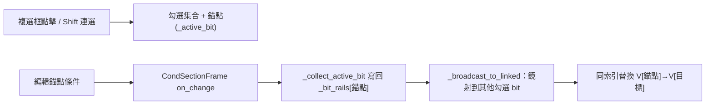

# 同時設定 vector 多個 bit：複選框 + 即時共編（乙 + 自動同索引）

## 決策（已與使用者確認）
- 編輯語意：**即時共編**——錨點 bit 的每次編輯即時鏡射到所有勾選 bit。
- 索引：**自動同索引替換**——鏡射時把「與錨點同索引」的 vector 相依 `V[錨點]→V[目標]`，其他固定索引（`V[0]` 等）與 scalar/High/Low 原樣。
- UI：**複選框取代現有 Bit 切換鈕**，Shift 連選；錨點=最後一次正常點擊的 bit，顯示其編輯器。單一勾選=今天的單 bit 行為。
- 已接受取捨：對勾選中、原本條件不同的 bit，第一次編輯就被錨點覆蓋（live 覆蓋）。
- 邊界：全部在 [src/gui/widgets.py](src/gui/widgets.py)；每 bit 獨立 `ConditionConfig` 模型、`cond_ir`、序列化、五後端、golden 皆不動。

## 資料流


## 改動明細（[src/gui/widgets.py](src/gui/widgets.py)）

### 1. Bit 複選框列（取代 SegmentedButton）
`_build_cond_pane`（line ~1269）與 `_sync_bit_selector`（line ~1368）：把 `self._bit_seg`（`CTkSegmentedButton`）改成一列 `CTkCheckBox`，每 bit 一個，狀態存 `self._bit_link_vars: list[ctk.BooleanVar]`，另存 `self._anchor_idx`。
- 複選框點擊沿用 [src/gui/dialogs.py](src/gui/dialogs.py) `_on_checkbox_click`（line ~192）同一套 Explorer 規則：直接綁 `cb._canvas`/`cb._text_label` 的 `<Button-1>`（不設 `command=`，避免雙重 toggle），`shift = bool(event.state & 0x0001)`，Shift 用 `anchor..idx` 區間。
- 正常點擊：`toggle(idx)` + `_active_bit=idx` + `_anchor_idx=idx` → `_collect_active_bit()` → 重建錨點編輯器（等同現在的 `_on_bit_selected`，但不廣播）。
- `_sync_bit_selector`：width 改變時重建複選框列，預設只勾錨點（`{_active_bit}`），避免意外廣播；非 vector（width 1）整列隱藏，與今日一致。
- 加一行提示 label：「連動編輯：勾選的 bit 會一起套用（Shift 連選）」。

### 2. 即時廣播接線
`_build_bit_editor`（line ~1294）output 區塊的三個 `CondSectionFrame` 目前沒有 `on_change`；改為傳入 `on_change=self._on_cond_live_change`。input 的 `InputWaveCondFrame` 已有 `on_change` 參數，同樣接上。
```python
def _on_cond_live_change(self):
    self._collect_active_bit()          # 先把錨點寫回 _bit_rails[_active_bit]
    self._broadcast_to_linked()

def _linked_targets(self) -> list[int]:
    checked = {i for i, v in enumerate(self._bit_link_vars) if v.get()}
    checked.add(self._active_bit)        # 錨點恆為來源
    return sorted(i for i in checked if i != self._active_bit)
```

### 3. 鏡射 + 同索引替換
```python
def _broadcast_to_linked(self):
    src = self._bit_rails[self._active_bit]
    for j in self._linked_targets():
        self._copy_cond_reindexed(src, self._bit_rails[j], self._active_bit, j)

def _reindex_name(self, name: str, src: int, dst: int) -> str:
    # V[src] → V[dst]，僅當 V 是 vector base 且索引 == src；其餘原樣
    p = name.rfind("[")
    if p < 0 or not name.endswith("]"):
        return name
    base, idx = name[:p], name[p+1:-1]
    if idx.isdigit() and int(idx) == src and self._dep_vector_width(base) is not None:
        return _bit_name(base, dst)
    return name
```
`_copy_cond_reindexed(src_rail, dst_rail, src_bit, dst_bit)`：深拷貝來源條件後，對**名稱**欄位套 `_reindex_name`、對**位置性**欄位（inv/use/group_inv/intra_op 的 groups 版）原樣複製：
- output：`depends_on_{hi,lo,force}`、`depends_on_{hi,lo,force}_groups`（逐名替換）；`*_inv`/`*_use` flat dict 重新 key（替換後的名）；`*_inv_groups`/`*_use_groups`/`*_group_inv`/`*_intra_op` 位置性直接複製。寫回 `dst_rail.cond`。
- input：`hi_groups`/`lo_groups` 逐名替換，其餘 wave 欄位位置性複製。
重用既有 `_dep_vector_width`（判斷 vector base）與 `core.config_models._bit_name`（已 import）。

### 4. 只在編輯時廣播，不在「切換檢視/收集」時廣播
`_collect_active_bit`、`_sync_bit_selector`、`get_rails`、Apply 路徑都**不**呼叫廣播；只有 `_on_cond_live_change`（編輯事件）會。切換檢視 bit 只收集+重建，不覆蓋其他 bit。

## 已知取捨與邊界情形（寫進 docstring）
- 同索引替換用「停存名稱」啟發式：編輯錨點 `i` 時，固定參照 `V[i]`（索引剛好等於自己）也會被當同索引替換成 `V[j]`。這是 Option A 糖衣的固有模糊（無持久化意圖），已於 `doc/FUTURE.md` 的 Option B 記後續。
- 鏡射是「整組覆蓋」：對勾選中原本不同的 bit，首次編輯即被錨點覆蓋（符合 live 語意）。

## 測試（[tests/test_gui_vector.py](tests/test_gui_vector.py)）
- `_reindex_name`：`V[0]`(src=0)→`V[1]`；`W[1]`(src=0) 不變；scalar `A`、`High` 不變；非 vector base 的 `X[0]` 不變。
- `_copy_cond_reindexed`：來源 bit0 的 Hi groups `[["V[0]","W[1]"]]` 鏡射到 bit1 → `[["V[1]","W[1]"]]`，inv/use/op 位置性保留。
- `_broadcast_to_linked`：勾選 {0,1,2}、編輯錨點 0 後，bit1/bit2 取得同索引替換後的副本；未勾選的 bit 不受影響。
- 複選框接線（`ctk_root`）：模擬 `_on_checkbox_click` 正常點擊 + Shift 連選，斷言勾選集合與 `_active_bit`；單一勾選時編輯不影響其他 bit（回歸）。
- 既有 vector round-trip / bit 選擇器相關測試需同步改用複選框 API（如 `test_bit_selector_switch_keeps_edits`、`test_condition_tab_syncs_bit_selector_after_width_change` 改以複選框/`_active_bit` 斷言）。

## 文件
- README 功能條目補「vector 多 bit 即時共編（複選框 + Shift 連選、自動同索引）」。
- `doc/FUTURE.md` 的 Option B 段補一句：持久化同索引意圖可同時解掉「固定 `V[i]` 被誤替換」。

## 驗收
- 先紅測試（`_reindex_name`/鏡射/廣播）→ 實作 → `ci.bat` 全綠（ruff + pytest）。
- 手動：3-bit vector，勾選全部→在 bit0 設「同索引 V[i]」與一個 scalar 條件→bit1/bit2 自動得到 `V[1]`/`V[2]` 與同一 scalar；取消某 bit 勾選後編輯不再影響它。
