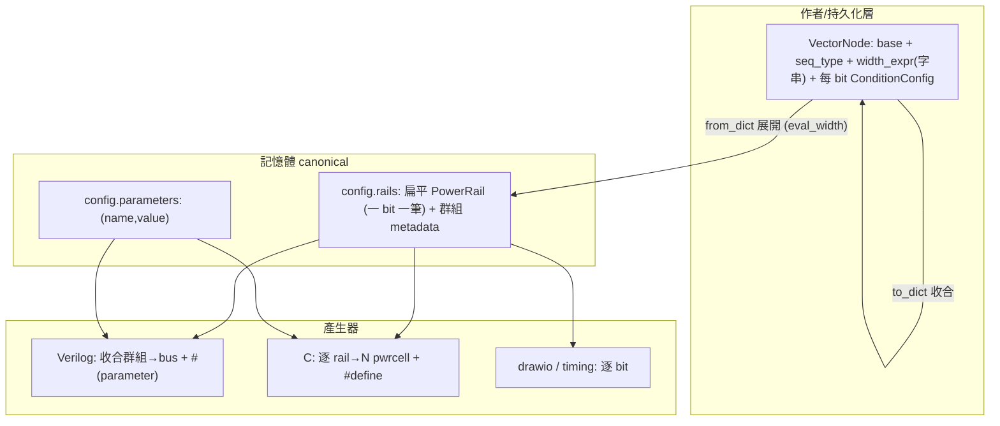

# Vector 節點與 Parameter 宣告（整合計畫）

把原「vector 分層」與「parameter 宣告」兩份合併為單一有序計畫。vector 是地基、parameter 疊其上，故**先做 vector 核心，再做 parameter 層**。依 `workflow.mdc`：每階段先紅測試 → 最小實作 → ci.bat 全綠 → 才進下一步；GUI 放各自區塊的最後。

## 現況核心問題

[`PowerRail`](src/core/config_models.py) 是 god object，身份（`name`/`seq_type`/`pulse_*`/`deb_*`/`cycle_*`/`init`/`force_val`）與條件（`depends_on_{hi,lo,force}_*` + 一堆 `get_*`）混在一起；節點恆為單一 bit，無 vector、無 parameter。

## 已確認的設計決策

- **vector = 陣列式**：N bit 展開成 N 個獨立 `PowerRail`（canonical 名 `base[i]`），config 以**扁平 rails + 群組 metadata** 保存，序列化收合成一筆。
- **每 bit 條件完全獨立**；條件只引用**具體 bit**（`FOO[2]`）→ `cond_ir` 與五後端葉節點不動。
- **身份 / 條件分層**（Extract Class）：抽出 `ConditionConfig`，`PowerRail` 委派，呼叫點零改動。
- **GUI 分層對稱**：宣告頁只留身份＋物理參數（Output: Timing(PSEQCELL)／Input: Debounce）；「條件」統一移到逐 bit 的條件步驟—Output 顯示 Hi/Lo/Force（`CondSectionFrame`）、Input 顯示 Timing Hi/Lo（`input_wave_frame`/`InputWaveCondFrame` sim 刺激），兩者並列、依選取 bit 的型別切換。
- **GUI 導覽（方案甲）**：身份/條件用「卡片內 `[宣告|條件]` 分段鈕」切換，各節點獨立；條件分頁的 Bit 選擇器只在 vector 出現（單一節點不顯示）。左側 `NodeListPanel` 維持**一列一 Node（vector 不展開 bit）**，加 vector 標記（`base [×N]`）；vector 的選取／rename／delete 整組作用（接 A4）。
- **左欄版面**：由上而下為 Nodes（`NodeListPanel`，weight 撐滿）／**Parameters（`ParameterPanel`，置於 Timing Signals 上方）**／Timing Signals（`PulsePanel`）。三區各自加可收合標題（點標題展開/收合，預設展開）。
- **Verilog 收合**：遇群組 rail 只在 bit 0 收合輸出一條 bus（`[k-1:0]` / `[(公式)-1:0]`）+ 加寬 wire + 一個 PSEQCELL `WIDTH`；per-bit body 先用 bit 0 代表。
- **C**：扁平 rails 已是 N 個 → 逐 rail 自然產生 N 個 `pwrcell`；parameter 以 `#define` 做對照。
- **parameter**：config 層 `(name,value)` 清單，輸出 Verilog `#(parameter ...)` 與 C `#define`；vector width 可為引用 parameter 的公式。
- **body 先不動（走乙再做）**：Verilog generate 迴圈 / C 陣列迴圈、真正 per-bit 條件渲染。

## 統一架構

### 設計模式

- **Extract Class + 委派（Facade）**：`ConditionConfig` 收 `depends_on_*`，`PowerRail` 組合並 `@property` 委派，下游零改動。
- **Elaboration / Builder**：`VectorNode` → N 個 `PowerRail`（`base[i]`）；`eval_width` 決定 N。
- **Adapter（持久化邊界）**：`to_dict` 收合群組、`from_dict` 展開，相容舊 JSON（無群組 = width 1、無 parameters = 空清單）。
- **群組收合（Verilog 專屬）**：以群組 metadata 判斷「是否 bit 0」決定收合輸出。

### 命名與範圍

- bit canonical 名 = `base[i]`；擴充 [`naming.py`](src/core/naming.py) `safe_name` 使 `FOO[2]`→合法 identifier `FOO_2`；新增展開後撞名驗證。
- `width_expr` **一律存字串**（整數期 `"2"`、parameter 期 `"NUM_CPU*2"`），`_width_prefix` 整數→`[k-1:0]`、公式→`[(expr)-1:0]`。
- `ConditionConfig` 只收 `depends_on_{hi,lo,force}_*`；input-wave 的 `hi_groups/...` 留在節點層。
- `cond_ir`/`codegen`/`timing`/`drawio`/`validator` 對**無 vector/parameter 的既有 config 行為不變**，靠 [`tests/golden/`](tests/golden) byte 鎖定反證。

## 分階段順序

A. Vector 核心：1 分層 → 2 模型/序列化 → 3 命名/驗證 → 4 群組批次操作
B. Vector 產出/介面：5 產生器（整數寬度）→ 6 GUI → 7 Excel
C. Parameter 層：8 資料+eval_width → 9 產生器宣告（Verilog `#(parameter)` + 符號寬度 / C `#define`）→ 10 驗證 → 11 GUI
D. 12 文件/skill 同步
